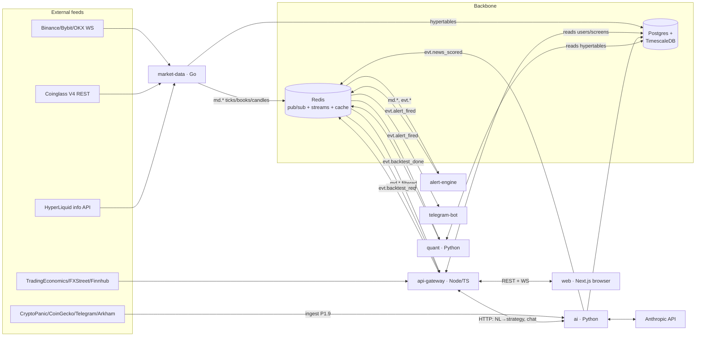

# Architecture — «TERMINAL»

Status: **Accepted** (F0.2) · Owner: John · Last updated: 2026-07-11
Companion to `CLAUDE.md` (the contract). Where they disagree, `CLAUDE.md` wins.

This document records the load-bearing architectural decisions (ADRs), the service
boundaries, the data flow, the Redis naming scheme, and the error/reconnect conventions
every service must implement. Anything not decided here is open; anything decided here
changes only via a new ADR superseding the old one.

---

## 1. Architecture decision records

### ADR-001 — Tech stack (recorded, decided in CLAUDE.md §4)

**Status:** Accepted (externally, in `CLAUDE.md`). Recorded here for traceability only —
not re-litigated.

TypeScript/React/Next.js for the app, Go for the market-data hot path, Python for
quant + AI, PostgreSQL + TimescaleDB + Redis for storage, WebSocket to the browser,
Tauri for desktop (Phase 3).

### ADR-002 — Service topology: modular services around a Redis backbone

**Context.** We need exchange-feed ingestion at high throughput (Go), CPU-bound quant
work (Python), LLM orchestration (Python), and a user-facing API — four workloads with
different scaling profiles and languages. A monolith would force one runtime; full
microservices with service mesh is overkill for a small team.

**Decision.** Six deployable services + the web app, communicating through **Redis**
(pub/sub for ephemeral fan-out, Streams for durable events) and **HTTP** for
request/response. No service-to-service ad-hoc coupling: if it's not Redis or a
documented HTTP endpoint, it doesn't exist.

**Consequences.** Each service scales and deploys independently; Redis is a single
point of failure (accepted for MVP — one managed instance, AOF persistence; revisit
before Phase 2 load).

### ADR-003 — api-gateway is Node/TypeScript (closing the "Node or Python" option)

**Context.** `CLAUDE.md` §4 leaves the gateway language open. The gateway's job is
auth, accounts, billing, REST, and **WebSocket fan-out to browsers** — I/O-bound,
type-shared with the frontend.

**Decision.** **Node.js + TypeScript** (Fastify + `ws`). Shared types from
`/packages/types` flow end-to-end (DB → gateway → browser) with zero translation;
Node's event loop is the right shape for tens of thousands of idle WS connections;
one less runtime in the request path. Python stays where it earns its place
(quant, ai).

**Consequences.** Billing/auth libraries chosen from the Node ecosystem. Any
gateway-side numeric work must respect the string-encoded decimal convention (§4.3) —
no float arithmetic on prices.

### ADR-004 — Redis: pub/sub for ticks, Streams for events, keyspace contract

**Context.** Market ticks are high-frequency and lossy-tolerant (a missed tick is
superseded milliseconds later). Alerts, news items, and liquidation events are
low-frequency and **must not be lost**.

**Decision.** Two transports with a hard rule:

- **Pub/Sub** (`md.*`) for market data — fire-and-forget, no persistence, consumers
  that fall behind lose ticks and resync from snapshots.
- **Streams** (`evt.*`) with consumer groups for domain events — at-least-once
  delivery, explicit ACK, dead-letter after 3 failed deliveries.

Naming scheme and envelope in §4. **No LLM ever consumes `md.*` directly** (prime
directive: deterministic code crunches numbers).

**Consequences.** Consumers of `evt.*` must be idempotent (at-least-once). Pub/sub
consumers must implement snapshot-resync (§5.4).

### ADR-005 — Single-writer rule for every table

**Context.** Three services touch Postgres. Shared write access to the same tables is
how data rots.

**Decision.** Every table has exactly one writing service (matrix in §3). Everyone
else reads, or asks the owner over HTTP/Streams. Migrations live with the owner.

**Consequences.** Occasional extra hop (e.g. alert-engine records fire-history via its
own table rather than touching user tables). Worth it.

### ADR-006 — Feeds are assumed hostile: mandatory resilience contract

**Context.** `CLAUDE.md` §2: every third-party feed is assumed unreliable.

**Decision.** Every feed consumer implements the conventions in §5 (backoff, heartbeat
staleness, sequence-gap resync, health states, degradation surfaced to the UI). This is
a build-time checklist, not a suggestion — PRs adding a feed without §5 compliance are
incomplete.

---

## 2. Service boundaries

| Service         | Lang                        | Owns (responsibility)                                                                                                            | Publishes                                                                    | Subscribes/Consumes                                             | Postgres writes                                                                    |
| --------------- | --------------------------- | -------------------------------------------------------------------------------------------------------------------------------- | ---------------------------------------------------------------------------- | --------------------------------------------------------------- | ---------------------------------------------------------------------------------- |
| `market-data`   | Go                          | Exchange WS ingestion (Binance/Bybit/OKX), order-book maintenance, normalization, candle building, Coinglass/HyperLiquid polling | `md.*` (pub/sub), `evt.liq`, `evt.funding` (streams), snapshots in `cache:*` | — (source)                                                      | `candles`, `oi`, `funding`, `liq_events` (hypertables)                             |
| `api-gateway`   | Node/TS                     | Auth, accounts, billing, BYO-key vault, REST API, browser WS fan-out, screener query engine                                      | `evt.audit`                                                                  | `md.*` (filtered fan-out), `evt.alert_fired`, `evt.news_scored` | `users`, `sessions`, `subscriptions`, `api_keys` (encrypted), `screens`, `layouts` |
| `quant`         | Python                      | Backtesting, indicators, spreads, formula liq-heatmap, real HL map (P2)                                                          | `evt.backtest_done`                                                          | `evt.backtest_req` (stream), reads hypertables                  | `backtests`, `strategy_results`                                                    |
| `ai`            | Python                      | Sonnet-5 orchestration, NL→strategy spec, news scoring, journal insights, agent runtime, locale injection                        | `evt.news_scored`, `evt.strategy_spec`                                       | `evt.news_raw`, `evt.journal_entry`, HTTP from gateway          | `strategies`, `agent_configs`                                                      |
| `alert-engine`  | (Go or TS, decide at P1.12) | Deterministic rule evaluation against live streams                                                                               | `evt.alert_fired`                                                            | `md.*`, `evt.news_scored`, `evt.liq`                            | `alerts`, `alert_history`                                                          |
| `telegram-bot`  | Node/TS                     | Mini-app backend, alert delivery to Telegram                                                                                     | —                                                                            | `evt.alert_fired` (consumer group `tg`)                         | `tg_links`                                                                         |
| `web` (Next.js) | TS                          | Landing (SSR) + terminal (SPA). Talks **only** to api-gateway                                                                    | —                                                                            | gateway WS                                                      | — (never touches DB/Redis)                                                         |

Boundary rules:

- The browser talks to **api-gateway only** (REST + one multiplexed WS). No service is
  internet-facing except the gateway and telegram-bot's webhook.
- Secrets (user exchange keys, Anthropic keys, vendor keys) exist only inside
  `api-gateway`'s vault and are passed server-side to `ai` per-request over localhost/
  private network — never to the browser, never into prompts, never into logs, never
  into Redis.
- `quant` and `ai` never open exchange connections; they read what `market-data`
  persisted.

---

## 3. Data flow



Hot path (latency-sensitive): exchange → `market-data` → Redis pub/sub → gateway →
browser WS. Everything else is warm (streams, HTTP) or cold (Postgres).

The LLM sits strictly off the hot path: `ai` consumes normalized, low-frequency events
(`evt.news_raw`, journal entries, explicit user requests) — never `md.*`.

---

## 4. Redis contract

### 4.1 Channel & key naming

Lowercase, dot-separated, symbols normalized to `{base}{quote}` lowercase
(`btcusdt`), exchange ids fixed (`binance`, `bybit`, `okx`, `coinglass`, `hyperliquid`).

Pub/Sub (ephemeral market data):

```
md.{exchange}.{symbol}.trades          # normalized trades
md.{exchange}.{symbol}.book            # L2 deltas
md.{exchange}.{symbol}.candles.{tf}    # tf ∈ 1m,5m,15m,1h,4h,1d
md.{exchange}.{symbol}.funding
md.{exchange}.{symbol}.oi
md.agg.{symbol}.ticker                 # cross-exchange aggregate (P2)
```

Streams (durable domain events):

```
evt.liq            evt.funding        evt.news_raw       evt.news_scored
evt.alert_fired    evt.backtest_req   evt.backtest_done  evt.strategy_spec
evt.journal_entry  evt.audit
```

Stream config: `MAXLEN ~ 100000` per stream; consumer groups named for the consuming
service (`gw`, `ae`, `tg`, `quant`, `ai`); pending entries older than 5 min are claimed
via `XAUTOCLAIM`; 3 failed deliveries → `evt.dlq.{stream}`.

Cache/state keys (Redis strings/hashes, always with TTL unless noted):

```
cache:book:{exchange}:{symbol}        # latest L2 snapshot (no TTL, overwritten)
cache:ticker:{exchange}:{symbol}      # TTL 10s
cache:screener:rows                   # TTL 2s — screener engine working set
health:{service}                      # TTL 15s heartbeat, see §5.5
sess:{sessionId}                      # gateway sessions
```

### 4.2 Message envelope

Every message on `md.*` and `evt.*` is a single JSON object:

```json
{
  "v": 1, // envelope version
  "type": "trade", // payload type, matches channel suffix
  "src": "binance", // origin feed
  "sym": "btcusdt", // normalized symbol (omit if N/A)
  "ts": 1783793088123, // event time (exchange), ms epoch
  "rts": 1783793088140, // receive time (ours), ms epoch — rts-ts = feed lag
  "seq": 812993, // per-channel monotonic sequence from the publisher
  "data": {} // type-specific payload
}
```

Rules: **prices and quantities are strings** (`"64123.50"`), never floats — parsing to
decimal happens at the edge that needs math. `seq` is per publisher per channel and
resets on publisher restart (consumers detect restart via `seq` regression + resync).
TS types for every payload live in `/packages/types` (`@terminal/types`), generated
mirror for Go and Python — types package is the source of truth.

### 4.3 Numeric convention (cross-cutting)

String-encoded decimals end to end; convert to `decimal`/`big.Float`/`Decimal` only
inside computation kernels; never `parseFloat` on money-bearing values in TS outside
display code. This rule exists because a screener showing `0.30000000000000004%` is
how terminals lose trust.

---

## 5. Error, reconnect & health conventions (mandatory per ADR-006)

### 5.1 Reconnection

Exponential backoff with full jitter: `delay = rand(0, min(cap, base·2^attempt))`,
base 1 s, cap 60 s, attempt counter resets after 60 s of healthy connection. Never
tight-loop; never give up permanently — a feed that's down for 6 hours reconnects on
attempt N like it was attempt 1 after the cap.

### 5.2 Heartbeat & staleness

Every feed defines an expected message interval. If nothing (data or ping) arrives in
`3×` that interval → mark the feed **STALE** and force-reconnect. Exchange-level pings
are answered within 1 s (Binance drops unanswered pings).

### 5.3 Sequence gaps (order books)

L2 books track exchange sequence numbers. On a gap: drop the local book, mark the
symbol STALE, fetch a REST snapshot, replay buffered deltas, resume. Never publish
from a book that has a known gap.

### 5.4 Snapshot-resync for pub/sub consumers

Because `md.*` is lossy by design, every consumer must be able to rebuild state from
`cache:book:*` / `cache:ticker:*` snapshots + resubscribe, and must do so on:
subscribe start, `seq` gap or regression, or self-detected staleness.

### 5.5 Health states & reporting

Four states per feed and per service: `LIVE → DEGRADED → STALE → DOWN`.

- `DEGRADED`: connected but lagging (`rts-ts` p95 > 2 s) or partial (some symbols dark).
- `STALE`: no data past heartbeat threshold; reconnecting.
- `DOWN`: reconnect failing ≥ 5 min.

Every service: (a) writes `health:{service}` hash to Redis every 5 s (TTL 15 s) with
per-feed states; (b) serves `GET /healthz` (liveness: process up) and `GET /readyz`
(readiness: dependencies OK) returning the same JSON shape:

```json
{
  "status": "LIVE",
  "feeds": { "binance.ws": "LIVE", "coinglass.rest": "DEGRADED" },
  "lagMsP95": 240,
  "updatedAt": 1783793088000
}
```

### 5.6 Graceful degradation (user-visible)

The gateway aggregates `health:*` and pushes it to the terminal; panels render stale
data **dimmed with an age badge** rather than blanking. A dead feed degrades one panel,
never the terminal. Alert-engine suppresses (and flags) rules whose input feed is
STALE/DOWN instead of evaluating against stale prices.

### 5.7 Logging & errors

Structured JSON logs (`level`, `svc`, `feed`, `sym`, `event`, `err`) — machine-parseable
from day 1. **No secrets, tokens, or key material in logs, ever** (CLAUDE.md §9).
Errors carry stable codes (`MD-1001` seq gap, `GW-2001` auth, …) so the UI and docs can
reference them; registry lives in `/packages/types`.

---

## 6. Non-goals (for now)

Kubernetes/service mesh (single-host Docker Compose until it hurts), Kafka (Redis
Streams until throughput proves otherwise — revisit at P2.1 order-book aggregation),
GraphQL (REST + WS is enough), multi-region (MVP is single-region).

---

_Supersedes: nothing (first ADR set). Next expected ADRs: F0.3 schema decisions
(`/docs/schema.md`), P1.12 alert-engine language, P2.1 backbone re-evaluation._
