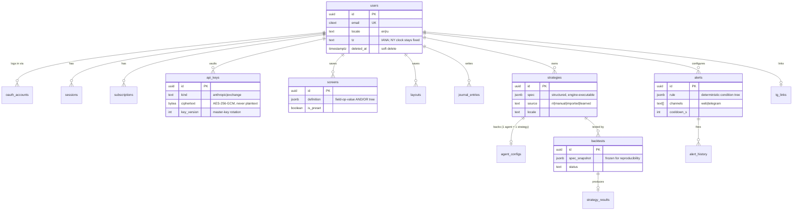

# Database schema — Postgres + TimescaleDB

Status: **Accepted** (F0.3) · Owner: John · Last updated: 2026-07-13
Companion to `/docs/architecture.md` (ADR-005: single writer per table) and
`CLAUDE.md` §4/§9. Migrations live with their owning service; `db/migrate.sh`
sequences them.

---

## 1. Principles

- **One database (`terminal`), one schema (`public`), six service roles.** ADR-005 is
  enforced by grants: every role can `SELECT` everything; only the owner gets
  `INSERT/UPDATE/DELETE` on its tables. A service writing outside its boundary fails at
  the DB, not in code review.
- **`NUMERIC` for every price/quantity/rate** — never `float`/`double precision`
  (architecture.md §4.3). `timestamptz` (UTC) for every instant.
- **Hypertables for anything append-only and time-keyed** (candles, OI, funding,
  liquidations, alert history) with compression + retention policies. Plain tables for
  entity state.
- **Soft deletes (`deleted_at`)** on user-facing entities (users, screens, journal,
  strategies, alerts) — partial indexes keep active-row queries fast. Hard deletes only
  via `ON DELETE CASCADE` from `users` (account erasure = GDPR path).
- **Secrets are ciphertext only** (`api_keys`): AES-256-GCM in the gateway process,
  master key from env/KMS, `key_version` for rotation. The DB, logs, and prompts never
  see plaintext (CLAUDE.md §9).
- **JSONB for specs the code validates** (screener definitions, alert rules, strategy
  specs, layouts): schemas live in `@terminal/types`; the DB stores, the app validates.
  These are deterministic structures the engines execute — the LLM may author them, but
  never interprets them at query time.

## 2. Ownership & apply order

| #   | Migration                                      | Owner (writer)     | Tables                                                                          |
| --- | ---------------------------------------------- | ------------------ | ------------------------------------------------------------------------------- |
| 0   | `db/bootstrap/0000_extensions_roles.sql`       | —                  | extensions (timescaledb, citext), 6 roles, default read grants                  |
| 1   | `api-gateway/0001_users_auth.sql`              | `svc_api_gateway`  | `users`, `oauth_accounts`, `sessions`, `subscriptions`, `api_keys`, `audit_log` |
| 2   | `api-gateway/0002_screens_layouts_journal.sql` | `svc_api_gateway`  | `screens`, `layouts`, `journal_entries`                                         |
| 3   | `api-gateway/0003_users_email_nullable.sql`    | `svc_api_gateway`  | `users` (drops `email NOT NULL`, for Telegram-only accounts)                    |
| 4   | `api-gateway/0004_layout_tabs.sql`             | `svc_api_gateway`  | `layouts` (`is_default`→`is_active`, `+title`, `+sort_order`: P1.3a tabs)       |
| 5   | `market-data/0001_hypertables.sql`             | `svc_market_data`  | `candles`ᴴ, `oi`ᴴ, `funding`ᴴ, `liq_events`ᴴ, `instrument_state`                |
| 6   | `alert-engine/0001_alerts.sql`                 | `svc_alert_engine` | `alerts`, `alert_history`ᴴ                                                      |
| 7   | `ai/0001_strategies.sql`                       | `svc_ai`           | `strategies`, `agent_configs`                                                   |
| 8   | `quant/0001_backtests.sql`                     | `svc_quant`        | `backtests`, `strategy_results`                                                 |
| 9   | `telegram-bot/0001_tg_links.sql`               | `svc_telegram_bot` | `tg_links`                                                                      |

ᴴ = hypertable. Order matters: everything FKs to `users`; `backtests` FKs to
`strategies`. Cross-service FKs are read-side integrity only and don't violate
single-writer (writes still go through the owner).

## 3. ERD (entity relationships, hypertables excluded)



Time-series tables (no FK edges by design — high-volume, exchange-keyed):

| Hypertable      | Key                                 | Chunk | Compress after | Retain |
| --------------- | ----------------------------------- | ----- | -------------- | ------ |
| `candles`       | (exchange, symbol, tf, ts)          | 1 d   | 7 d            | 730 d  |
| `oi`            | (exchange, symbol, ts)              | 1 d   | 7 d            | 365 d  |
| `funding`       | (exchange, symbol, ts)              | 7 d   | 30 d           | 730 d  |
| `liq_events`    | dedupe-unique, indexed (symbol, ts) | 1 d   | 7 d            | 365 d  |
| `alert_history` | (alert_id, fired_at) indexed        | 7 d   | —              | 180 d  |

Compression is `segmentby (exchange, symbol[, tf])`, `orderby ts` — the natural query
shape (`WHERE symbol = ? AND ts > ?`) hits one segment.

## 4. Access patterns the indexes serve

- **Screener** (P1.6/P1.7): reads `instrument_state` (thousands of rows, updated in
  place by market-data) — `volume_24h DESC` index for the primary sort; filters are
  in-memory over the working set, not per-keystroke SQL.
- **Charts**: `candles` PK `(exchange, symbol, tf, ts)` → range scan per panel.
- **Liquidation heatmap** (P1.14): `liq_events (symbol, ts DESC)` + Coinglass bought
  data (cache layer, not persisted for MVP).
- **Alert reaper**: partial index on `alerts(status) WHERE active` keeps the engine's
  reload cheap; `alert_history (alert_id, fired_at DESC)` powers the per-alert log.
- **Journal**: `(user_id, ts DESC) WHERE deleted_at IS NULL` + GIN on `tags`.
- **Session validation** (every request): unique `token_hash` lookup; `expires_at`
  index for the reaper.

## 5. Deliberate deferrals (documented so they're decisions, not oversights)

- **Continuous aggregates** (1m → rollups): we ingest exchange-native timeframes
  instead for MVP. Revisit when we compute our own candles from trades (P2.1).
- **Order-book snapshots/deltas in Postgres**: no — books live in Redis
  (`cache:book:*`); Postgres only gets derived series. Revisit at P2.1.
- **News storage**: P1.9 will add `news_items` (owner: `svc_ai`) — deferred until the
  ingest shape is known; scored output flows over `evt.news_scored` meanwhile.
- **`alert_history` compression**: JSONB payloads compress poorly segment-wise; plain
  retention (180 d) is enough at MVP volume.
- **Row-Level Security**: single-tenant-per-row app with service roles; RLS adds cost
  without a threat model win pre-Phase-3. Re-evaluate with the Phase-3 legal review.
- **Marketplace/copy-trading tables** (P4): endgame; not scaffolded now.

## 6. Running migrations

```bash
createdb terminal
DATABASE_URL=postgres://localhost:5432/terminal ./db/migrate.sh
```

`schema_migrations` records applied files; the script is idempotent and applies in
dependency order. Policy calls (`add_compression_policy`, `add_retention_policy`)
can't run inside transaction blocks in some TimescaleDB versions, so files apply
without `-1`; each file must remain internally re-runnable-safe after failure by
manual cleanup (acceptable at this stage; a real migration tool lands with P1.1 if
needed).
